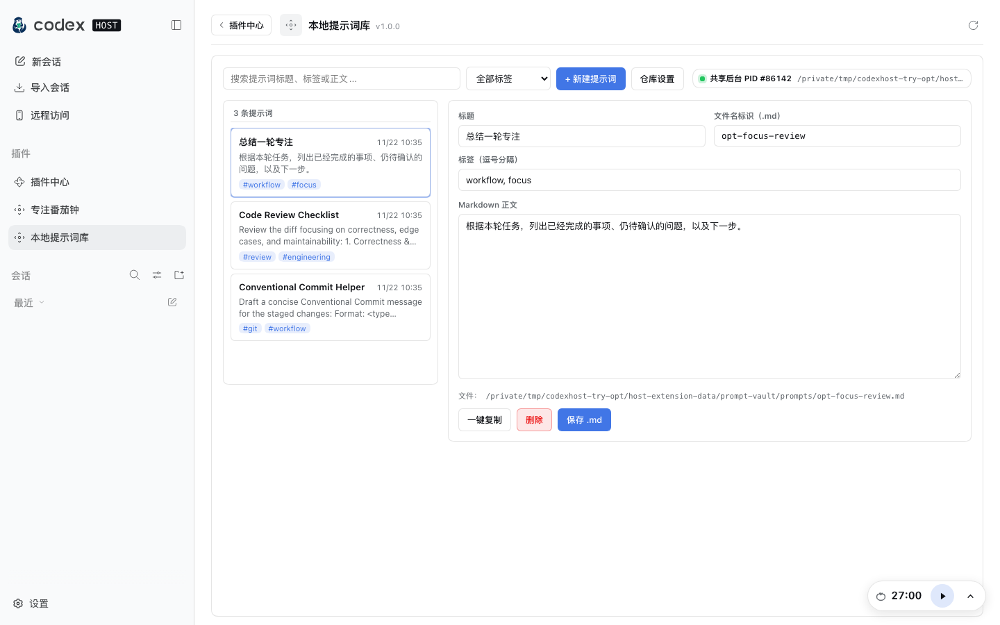

# Local Prompt Vault / 本地提示词库

## English

Local Prompt Vault is a CodexHost Desktop and Web workspace extension for saving, searching, tagging, editing, and copying reusable prompts. Each prompt is a Markdown file with `title`, `tags`, and `updatedAt` frontmatter. Both clients use the same vault when connected to the same Host.

**Install:** Download `prompt-vault.zip` from the [release](https://github.com/BytePioneer-AI/codexhost-ext-prompt-vault/releases/tag/v1.0.0). Import the ZIP in the CodexHost Extensions Center, enable it, and open **Prompt Vault** from the sidebar. Use a CodexHost build that supports unified v2 extensions with workspace pages and backends.

Files live in the extension’s Host data directory (`<dataDir>/prompts`) by default. To change that, set **Vault Directory** to an absolute path on the machine running the Host. Use a dedicated folder for prompts: the extension reads, edits, and deletes Markdown files there, and adds sample prompts when no Markdown files are present.

## 简体中文

本地提示词库是 CodexHost Desktop 和 Web 的工作区扩展，可保存、检索、编辑、按标签筛选及一键复制提示词。每条提示词都保存为一个 Markdown 文件，文件头包含 `title`、`tags` 和 `updatedAt`。连接到同一个 Host 的客户端共用同一份提示词库。

**安装：** 从 [Release](https://github.com/BytePioneer-AI/codexhost-ext-prompt-vault/releases/tag/v1.0.0) 下载 `prompt-vault.zip`，在 CodexHost 插件中心导入并启用，然后从侧边栏打开 **本地提示词库**。需要支持统一 v2 扩展工作区页面及后台的 CodexHost 版本。

文件默认保存在 Host 的扩展数据目录 `<dataDir>/prompts`。可在 **提示词目录** 中填写 Host 所在机器上的绝对路径。建议使用专用目录：扩展会读取、修改和删除其中的 Markdown 文件；如无 Markdown 文件，则写入示例提示词。

## License / 许可证

[MIT](LICENSE)
